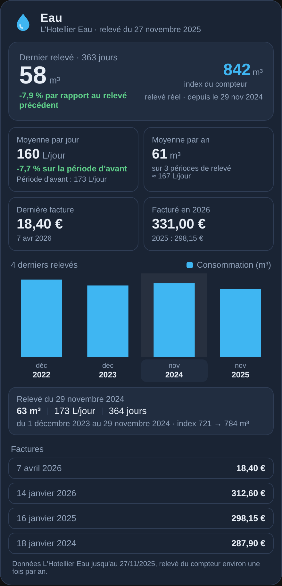

# L'Hotellier Eau pour Home Assistant

Intégration Home Assistant pour l'**espace client L'Hotellier Eau** (`serviceclients.lhotellier-eau.fr`). Elle récupère l'index de votre compteur d'eau, vos relevés et vos factures, et s'utilise dans le **tableau Énergie** (section Eau).

> Intégration non officielle, sans lien avec L'Hotellier. Elle lit les données de votre espace client avec vos identifiants.

## Capteurs

| Capteur | Description |
| --- | --- |
| Index compteur | Dernier index relevé, en m³ (pour le tableau Énergie) |
| Dernière consommation relevée | Consommation du dernier relevé, en m³, avec le total par année en attribut |
| Dernier relevé | Date et heure du dernier relevé |
| Dernière facture | Montant de la dernière facture, en €, avec l'historique en attribut |
| Date dernière facture | Date de la dernière facture |
| Mode de paiement | Diagnostic |

Les données sont mises à jour toutes les 12 heures. Les relevés de compteur sont peu fréquents : l'index ne change qu'à chaque nouveau relevé.

## Carte

L'intégration fournit sa carte, dans le même style que les cartes Enedis Linky New et Gazpar. Elle est chargée automatiquement : aucune ressource à ajouter.

```yaml
type: custom:lhotellier-eau-card
```



- **Dernier relevé** : consommation de la période, évolution par rapport au relevé précédent, index du compteur.
- **Tuiles** : moyenne par jour (en litres), moyenne par an, dernière facture, total facturé dans l'année.
- **Graphique** des relevés : un clic sur un relevé donne son détail (période, litres par jour, index de début et de fin).
- **Factures** : les dernières factures, les avoirs en vert.

Les capteurs sont trouvés seuls. Options (toutes dans l'éditeur visuel) :

| Option | Par défaut | Description |
| --- | --- | --- |
| `entity` | trouvé seul | capteur **Index compteur** |
| `bill_entity` | trouvé seul | capteur **Dernière facture** |
| `title` | `Eau` | titre de la carte |
| `reads` | `6` | relevés dans le graphique (3, 6 ou 10) |
| `show_bills` | `true` | liste des factures |
| `bills` | `4` | factures affichées (2, 4 ou 8) |
| `theme` | `v2` | `v2` (bleu nuit), `auto` (clair ou sombre selon Home Assistant), `ha` (thème Home Assistant) |
| `font_size` | `100` | taille du texte, en % |

## Installation

1. **Paramètres › Marketplace** (ou HACS avant Home Assistant 2026.11) › menu ⋮ › **Dépôts personnalisés**.
2. Ajoutez `https://github.com/Marlboro62/lhotellier-eau`, catégorie **Intégration**.
3. Installez **L'Hotellier Eau**, puis redémarrez Home Assistant.

## Configuration

**Paramètres › Appareils et services › Ajouter une intégration › L'Hotellier Eau**, puis saisissez l'identifiant (adresse e-mail) et le mot de passe de votre espace client.

Si le mot de passe change, Home Assistant vous propose de le saisir à nouveau.

### Tableau Énergie

L'intégration importe tous les relevés et toutes les factures de l'espace client dans les statistiques longue durée de Home Assistant, y compris les années passées :

- **L'Hotellier Eau – Consommation** : consommation en m³, comptée à la date de chaque relevé ;
- **L'Hotellier Eau – Factures** : montants facturés en €, comptés à la date de chaque facture.

**Paramètres › Tableaux de bord › Énergie › Consommation d'eau › Ajouter une source d'eau**, puis choisissez la statistique **L'Hotellier Eau – Consommation**. Pour le coût, choisissez « Utiliser une entité suivant les coûts totaux » et la statistique **L'Hotellier Eau – Factures**.

Les identifiants des statistiques sont dans l'attribut `statistique` des capteurs **Index compteur** et **Dernière facture**.

## Support

Les demandes et les problèmes passent uniquement par les [issues GitHub](https://github.com/Marlboro62/lhotellier-eau/issues).

## Licence

MIT
